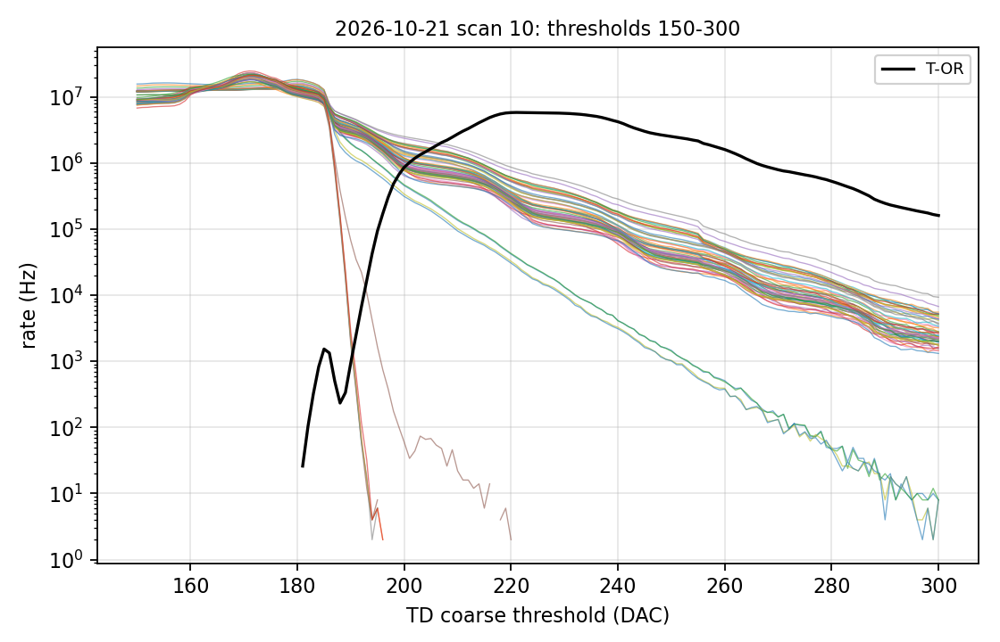
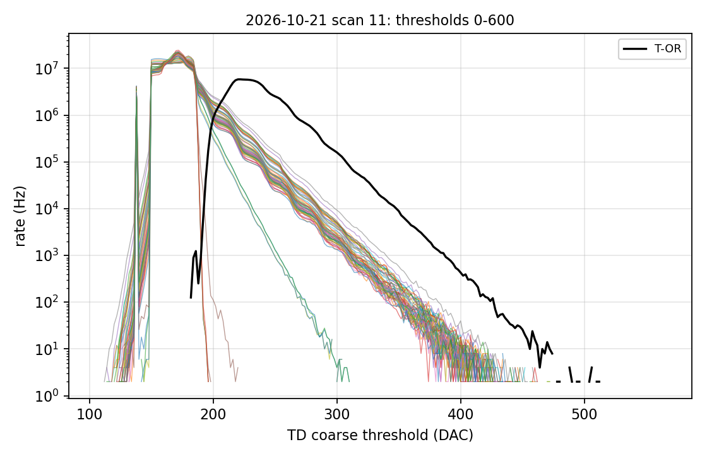

# Bench data of 21 October 2026: first look

Data measured by Laura Navarro on 21 Oct 2026 with the A5202 (board 0) and the PET CAEN DAQ,
copied from hyperion:/data/lnavarro/26_10_caen_measurements_jj. The runs follow bench note 1
(Citiroc noise). Channels are numbered 0-63 as in the DAQ.

## 1. Data received

| Item | Content | Logbook |
|---|---|---|
| run-1 ... run-9 | decoded events, histograms, manifest; about 10 000 periodic triggers (1 ms) each | yes |
| scan-10 | staircase, TD coarse threshold 150-300, step 1 | no |
| scan-11 | staircase, TD coarse threshold 0-600, step 2 | no |
| hold-scan-12 | hold delay 0-248 ns, step 8 ns, 10 000 events per point | no |

The staircase.h5 artifacts of scans 10 and 11 were not in the directory; the same numbers are in
their points.jsonl, which is what was read.

## 2. Runs 1-9 and hold scan 12: every value at full scale

| Run | Step | HG shaping | HoldDelay | T detector | T board | HV current |
|---|---|---|---|---|---|---|
| 1, 2, 3 | 1 | 25, 50, 87.5 ns | 0 ns | 24.8 C | 50.0-50.5 C | 0.3-0.4 uA |
| 4-8 | 2 | 25 ns | 96, 200, 296, 400, 496 ns | 24.7 C | 50.5 C | 0.3 uA |
| 9 | 3 | 25 ns | 0 ns | 24.7 C | 50.5 C | 0.3 uA |

No trigger was lost and all 64 channels are present in every event. **But every measurement of
every channel, in the high and the low gain, is 8191**, the full scale of the 13-bit ADC, in all
nine runs and at all 32 points of the hold scan. The value does not change with the shaping, the
hold delay or the gain. The noise of the electronics therefore cannot be measured from these
files.

This does not look like a property of the SiPMs: the HV current is 0.3 uA (64 SiPMs above
breakdown would draw tens of uA), and the charge discriminator is never set. 8191 is all 13 bits
at one, the value one expects when the ADC does not convert, or when a decoder writes a default.

Two differences with the logbook:

- The files record HV_Vbias = 40.7 V (HV_IndivAdj = 0, HV_Adjust_Range = 4.5 V); the logbook
  says 36.5 V. If the individual adjustment subtracts the full 4.5 V, the SiPMs see about 36.2 V,
  which agrees with the current.
- The temperature of the logbook (50-50.5 C) is that of the board. The detector was at
  24.7-24.8 C, the FPGA at 59 C, the HV module at 49-50 C.

## 3. Staircases (scans 10 and 11)

Rate of the timing discriminator of each channel against its coarse threshold:

- **Baseline.** Up to the edge of a plateau at 180-185 DAC (the same in all channels, within
  5 DAC) the rate is 1.3-2.2 x 10^7 Hz: the threshold sits in the noise of the fast shaper. Below
  about 150 the rate drops to zero, presumably because the discriminator output stays high and
  no edge is counted.
- **Dark counts in 54 channels.** Above the plateau the rate falls slowly and with shoulders,
  about 6 x 10^5 Hz 30 DAC above the edge (median), 10^4 Hz near 280, 10 Hz near 400. This is
  the staircase of the dark counts (1, 2, 3 ... pe). **The SiPMs were therefore above breakdown
  during the scans**, unlike in the runs; the scan manifests do not record the HV.
- **No avalanches in 6 channels: 15, 55, 57, 59, 61, 63.** Their rate falls from the plateau to
  zero within 10 DAC; 30 DAC above the edge they count 0-4 Hz.
- **Low dark rate in 4 channels: 0, 2, 8, 10.** 60-90 kHz 30 DAC above the edge, 7-10 times below
  the median. In the figures these are the two isolated curves below the bundle.
- **T-OR.** Zero below a threshold of 182, while every channel counts about 10^7 Hz there; probably
  the OR saturates.
- **One invalid point.** Scan 11, channel 61, threshold 490: the DAQ wrote 3735928559 counts,
  i.e. 0xDEADBEEF. It is left out of the figure.

The 10 channels without or with few avalanches will be a problem in what follows: if they see
no avalanches they cannot be calibrated with the periodic trigger and will not record the light
of the crystal. Five of the six silent channels are the odd channels 55-63, and the four weak
ones are even channels 0-10, which suggests a connector or a mapping rather than single SiPMs.

## 4. Questions

1. **(JMB)** Why is every value 8191, in both gains and in the hold scan? Does the ADC not convert
   with this configuration (PEAK_STRETCH, Pedestal = 0, periodic trigger), or does the decoder
   write a default? The same configuration in Janus would tell which.
2. **(JMB)** Scan 11 contains 0xDEADBEEF as the count of channel 61 at threshold 490: where does
   it come from?
3. **(Laura)** What was the HV during scans 10 and 11? Were the runs and the scans taken with the
   same HV settings?
4. **(Laura)** What voltage does each SiPM see with HV_Vbias = 40.7 V and HV_IndivAdj = 0:
   about 36.2 V?
5. **(Laura)** Are SiPMs connected to channels 15, 55, 57, 59, 61 and 63? Is anything different
   about 0, 2, 8 and 10 (connector, position in the array)?
6. **(Laura)** Could the logbook get rows for scans 10, 11 and 12 (time, settings, HV), with
   the temperature of the detector rather than the board? And could the staircase.h5 artifacts
   be copied?

## 5. Tools

- julia --project=. fullsim_analysis/scripts/bench/inspect_run.jl benchdata/2026-10-21 writes
  runs.csv, channels.csv and hold_scan.csv here and prints the warnings.
- python3 fullsim_analysis/plots/staircase.py benchdata/2026-10-21 writes staircase_N.csv,
  staircase_N_channels.csv and staircase_N.png here.
